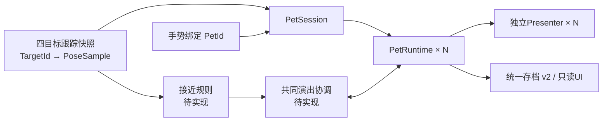

# 桌上有龙：项目架构与技术架构

> 建立日期：2026-09-11。本文把分散在开题说明、开题报告、AGENTS.md 与技术栈文档里的架构描述
> 收拢成一份可施工的说明书，并记录**骨架已搭建到哪一步**。
>
> **状态纪律（2026-10-27更新）：第1～6节描述当前源码，即 P2 多宠竖切 + P3 手势与满值闭环后的实现。** 食物卡玩法已退出运行；跟踪/交互契约按稳定 `TargetId`/`PetId` 泛化；`AppRoot` 用 `PetSession` 管理 N 只 `PetRuntime`；存档为 schema 2（v1 只读迁移）；`02_Main` 已重建为四卡各挂一只的主场景。单击/双击按宠独立识别，满值周期与四段正式专属片段、TouchReact 已接线。2026-10-27 真实 Unity 批处理 EditMode **161/161 通过**；**四宠场景未构建 APK、未真机测试**。仍待实现的是接近几何规则、跨宠演出协调器与共同大笑。当前范围见 [v0.3](交互与皮肤扩展设计.md)，资产见 [四色映射](四色奶蛙资产映射.md)。
> 本轮修复的 P1 缺陷（`versionDefines` 表达式非法导致 Vuforia 宏从未定义）见
> [代码审查问题与修复记录](../代码审查问题与修复记录.md) 第 4.5 节。

审查与回归证据：[代码审查问题与修复记录](../代码审查问题与修复记录.md)。

相关文档：[技术栈与开发环境](技术栈与开发环境.md)（工具与环境事实）、
[环境缺失与下载清单](环境缺失与下载清单.md)（要下载什么）、
[奶蛙最终版资产说明](奶蛙最终版资产说明.md)（冻结的角色资产）、
[开题报告](开题报告_AR萌宠互动系统.md) 4.1 节（本文的架构来源）。

---

## 1. 一页总览

**已实现（2026-10-27，P2 + P3）**：保留七层；原 Den/Food 固定槽位已换成稳定 `TargetId` 注册表；`AppRoot` 仍只有一份，用 `PetBinding[] pets` 表示"petId → 表现层"，`PetSession` 为每只宠物建独立的 `PetRuntime` + `TrackingStateMachine`；交互事件带 `PetId`；相机/输入采集/存档写入各一份；存档 schema 2 按 `PetId` 逐只保存，v1 只读迁移。P3 之后：`TapGestureRecognizer` 按宠判单击/双击，`Pet.HappyCycle` 管满值周期，满值直接播四段正式片段，`TouchReact` 与开心条已接。

**P4 + P5（2026-10-27）**：`Interaction.ProximityRule` 判两卡接近几何与迟滞，`Pet.SocialCoordinator` 管组划分、整组同帧开始/取消与成员冷却，`PetSession.TickSocial` 每帧把逐宠位姿交给两者（EditMode 223/223）。表现层 `FaceExpressionTable` + `PetPresenter.SetExpression` 用 per-Renderer `MaterialPropertyBlock` 在两片 Head 骨骼下的贴片上选图集格子，`ZQXNXS/FaceDecal` 按视线夹角朝相机前移；Core 新增 `PetExpression.Signature`，由表现层按形象解读（EditMode 231/231）。

**仍待实现**：特效、音效；四宠场景真机验证与 UI 观感整合。Presentation 继续只依赖 Core。

详细OOD、仲裁与P0～P7见 [设计v1](../designs-oo/202609211530_四色奶蛙互动改版/design_v1.md)（手势与满值参数已于 2026-10-27 定稿，独立审查未完成）。下图是**当前代码的分层协作**（食物与固定槽位已移除）。

~~~mermaid
flowchart TB
    subgraph 现实侧
        CAM[手机摄像头]
        CARD[四张角色卡 Target_card_*]
    end

    subgraph 跟踪层["① 跟踪层 Scripts/AR"]
        VS[VuforiaTrackingSource 或 StubTrackingSource 按 TargetId 出采样]
        MR[MarkerRegistryBase 按 TargetId 查世界位姿]
        TS[TrackingStateMachine 每宠一份]
    end

    subgraph 交互层["② 交互判定层 Scripts/Interaction"]
        TP[TouchPokeRule 触屏逗弄·DPI移动阈值]
        TG[TapGestureRecognizer 每宠单击/双击]
        IP[InteractionPipe 总闸门 + 去重]
    end

    subgraph 行为层["③ 行为状态机层 Scripts/Pet"]
        PR[PetRuntime 每宠：PetNeeds + 行为机]
        BP[BehaviorPolicy 优先级决策]
        BSM[BehaviorStateMachine 唯一结算点]
        CFG[PetConfig ScriptableObject]
    end

    subgraph 表现层["④ 表现层 Scripts/Presentation"]
        PP[PetPresenter Animator·表情·音效]
    end

    subgraph 界面层["⑤ 界面层 Scripts/UI"]
        UI[PetStatusPanel 跟踪提示·选中宠开心条·四宠列表开心值]
    end

    subgraph 数据层["⑥ 数据层 Scripts/Persistence"]
        SS[SaveService v2 主档/tmp/bak + v1 只读迁移]
        SC[SaveCoordinator 节流写盘 + 逐宠合并]
    end

    subgraph 平台层["⑦ 平台层 Scripts/Platform"]
        PL[CameraPermission AppLifecycle·PhotoCapture]
    end

    subgraph 装配层["装配层 Scripts/App"]
        APP[AppRoot 唯一组装点]
        PS[PetSession 逐宠槽位·事件路由]
        TI[TouchInputBridge / PetHitTarget]
    end

    CAM --> VS
    CARD --> VS
    VS --> MR
    VS --> TS
    TS -->|该宠不可交互| PS
    TI -->|petId| APP
    APP --> TP
    TP --> TG
    TG --> IP
    IP --> PS
    PS --> PR
    PR --> BSM
    BP --> BSM
    CFG --> BSM
    PR --> PP
    PR --> SC
    SC <--> SS
    PS --> UI
    TS --> UI
    PL --> TS
    APP -.组装.-> VS
    APP -.组装.-> PS
    APP -.组装.-> IP
~~~

**一句话概括**：跟踪层只回答"卡在哪、可不可信"，交互层只回答"这算不算一次操作"，
行为层只回答"接不接受、现在干什么、什么时候结算"，其余三层只负责"怎么显示、怎么存、怎么适配系统"。

---

## 2. 七层架构（自下而上）

开题报告定义的是五层：跟踪 → 交互 → 行为 → 表现 → 数据。施工时把**界面**与**平台适配**拆成独立程序集，
理由是这两块的改动频率与失败模式跟另外五层完全不同（界面随设计稿变、平台随安卓版本变），
但它们**不是新的业务层**，仍归入表现与数据两条纵向切面。层数不同不改变原有分层语义。

| # | 层 | 命名空间 | 程序集 | 职责 | 明确不做 |
| --- | --- | --- | --- | --- | --- |
| ① | 跟踪层 | `ZQXNXS.ARPet.AR` | `ZQXNXS.ARPet.AR` | 目标标识、世界米制位姿、有效性、更新时刻、按目标 ID 查询 | 不修改任何游戏数值；不做交互判定 |
| ② | 交互判定层 | `...Interaction` | `...Interaction` | 把触屏输入转成**一次性事件**（单击/双击识别已实现，接近几何待实现） | 不决定宠物接不接受；不碰动画 |
| ③ | 行为状态机层 | `...Pet` | `...Pet` | 长期状态数值、行为优先级、打断规则、**唯一结算点** | 不读位姿；不做距离判定 |
| ④ | 表现层 | `...Presentation` | `...Presentation` | Animator、表情、音效、特效 | 不写任何业务规则 |
| ⑤ | 界面层 | `...UI` | `...UI` | 状态面板、跟踪提示、反应图鉴、安全区适配 | 输入不得穿透到角色 |
| ⑥ | 数据层 | `...Persistence` | `...Persistence` | 版本化本地 JSON、异常恢复、写盘节奏 | 不保存场景对象引用 |
| ⑦ | 平台层 | `...Platform` | `...Platform` | 摄像头权限、生命周期、相册 | 不做业务判断 |

装配层 `Scripts/App/AppRoot.cs`（程序集 `ZQXNXS.ARPet.App`）不属于上面任何一层：
它是**唯一**知道各层如何拼在一起的地方，因此业务层可以完全脱离场景运行。

### 依赖方向由程序集强制

~~~text
Platform ─┐
UI ───────┼─→ Core
Presentation ─┤
Persistence ──┼─→ Pet ─→ Core
Interaction ──┘        ↑
AR ────────────────────┘（AR 只依赖 Core）
App ──→ 以上全部
~~~

关键约束（写进 `.asmdef` 的 `references`，编译期即失败，而不是靠约定）：

- **`Presentation` 不依赖 `Pet`。** 表现层通过 `Core.IPetPresenter` 接口被反向驱动，
  所以"行为规则被写进动画脚本"在结构上不可能发生。
- **`AR` 只依赖 `Core`。** 交互层通过 `Core.ITrackingSource` / `IMarkerRegistry` 拿数据，
  因此换掉 Vuforia 或换成模拟源，业务层一行都不用改。
- **`Core` 不依赖任何东西。** 它是共享词汇表：接口、枚举、只读结构。
- 没有任何程序集反向依赖 `App`，所以 `App` 可以随时替换组装方式（例如改成依赖注入容器）。

---

## 3. 程序集与目录对照

| 目录 | 程序集 | 主要文件 | 是否已写 |
| --- | --- | --- | --- |
| `Scripts/Core/` | `ZQXNXS.ARPet.Core` | `TrackingTypes.cs`、`ArContracts.cs`、`InteractionEvents.cs`、`PetState.cs`、`PetIdentity.cs`、`PresentationContracts.cs` | 是 |
| `Scripts/AR/` | `ZQXNXS.ARPet.AR` | `TrackingStateMachine.cs`、`MarkerRegistryBase.cs`、`StubTrackingSource.cs`、`VuforiaTrackingSource.cs`、`TargetTrackingProbe.cs` | 是（Vuforia 部分为条件编译） |
| `Scripts/Interaction/` | `ZQXNXS.ARPet.Interaction` | `TouchPokeRule.cs`、`TapGestureRecognizer.cs`、`InteractionPipe.cs`（`FeedingRule` 已于 2026-10-27 删除） | 是 |
| `Scripts/Pet/` | `ZQXNXS.ARPet.Pet` | `PetRuntime.cs`、`PetConfig.cs`、`PetNeeds.cs`、`BehaviorPolicy.cs`、`BehaviorStateMachine.cs`、`HappyCycle.cs` | 是 |
| `Scripts/Presentation/` | `ZQXNXS.ARPet.Presentation` | `PetPresenter.cs` | 是 |
| `Scripts/UI/` | `ZQXNXS.ARPet.UI` | `PetStatusPanel.cs`、`SafeAreaFitter.cs`（含 `UiInputBlocker`、`TrackingHintText`） | 是 |
| `Scripts/Persistence/` | `ZQXNXS.ARPet.Persistence` | `SaveFile.cs`（schema 2）、`SaveFileV1.cs`（只用于迁移解析）、`SaveService.cs`、`SaveCoordinator.cs` | 是 |
| `Scripts/Platform/` | `ZQXNXS.ARPet.Platform` | `PlatformServices.cs`（权限 / 生命周期 / 拍照占位） | 是 |
| `Scripts/App/` | `ZQXNXS.ARPet.App` | `AppRoot.cs`、`PetSession.cs`、`PetHitTarget.cs`、`TouchInputBridge.cs` | 是 |
| `Scripts/Editor/` | `ZQXNXS.ARPet.EditorTools` | `ProjectSetup.cs`、`PetSceneAssets.cs`、`VuforiaTargetDatabase.cs`、`FourCardTrackingSetup.cs`、`ExclusiveAnimationSetup.cs` | 是 |
| `Scripts/Tests/EditMode/` | `ZQXNXS.ARPet.Tests.EditMode` | 14 份测试文件：行为规则、存档 v2/迁移、逐宠会话与事件路由、触屏输入与手势识别、满值周期、四卡场景与主场景接线、Animator/可见性、专属动作 | 是；2026-10-27 报告 161/161 |
| `Scenes/` | — | `01_TrackingSmoke.unity`、`02_Main.unity`、`03_ExclusiveAnimationPreview.unity`、`04_FourCardTracking.unity` | 已生成；`02_Main` 为四色多宠主场景且唯一构建场景 |
| `Animations/`、`Configs/` | — | `Pet01Controller.controller`、`PetBehaviorConfig.asset` | 已生成；Idle + TouchReact + 四专属 + social_laugh 状态已接；Eat 为旧资产；DozeLoop/WalkLoop 未接 |
| `Art/Characters/Pet01/Materials/` | — | 基础 Skin/Oral/Eyes + 四色变体材质 | 已生成 |
| `Art/Characters/Pet01/`（表情） | — | `Pet01_FaceOverlay.fbx`、`Textures/Pet01_Face{Eyes,Mouth}.png`、`face_overlay_layout.json`、`Shaders/FaceDecal.shader`、`Materials/Pet01_Face*_Decal.mat` 与 8 份 `*Cover_<色>.mat` | 2026-10-27 已接线（菜单 5/6 装配），真机未测 |
| `Prefabs/`、`Art/UI`、`Art/VFX`、`Audio/` | — | 四色预制体、特效、音效 | 尚未制作/接线 |
| `../StreamingAssets/` | — | `Vuforia/ZQXS.xml`、`ZQXS.dat` | 库含四个 `card_*` 角色目标与两张旧占位目标；`02_Main` 使用四个 `card_*`，`04_FourCardTracking` 为独立实测场景 |
| `../Plugins/Android/` | — | `settingsTemplate.gradle` | 已有 Maven 镜像回退模板；相册原生能力待实现 |

---

## 4. 类图：核心协作关系

~~~mermaid
classDiagram
    class ITrackingSource {
        <<interface>>
        +bool IsRunning
        +string PauseReason
        +TargetIds string[]
        +GetSample(string) PoseSample
        +AllSamples PoseSample[]
        +StartTracking()
        +PauseTracking(string)
    }
    class IMarkerRegistry {
        <<interface>>
        +IsRegistered(string) bool
        +GetTargetSize(string) Vector3
        +IsPoseValid(string, float) bool
        +TryGetTargetPose(string, out Vector3, out Quaternion) bool
    }
    class IInteractionEventSink {
        <<interface>>
        +TrySubmit(InteractionEvent) bool
    }
    class IPetPresenter {
        <<interface>>
        +PlayBehavior(PetBehaviorId, string, bool, float)
        +SetExpression(PetExpression, float)
        +PlaySfx(string)
        +PlayFx(string)
        +SetPlaybackSpeed(float)
        +SetInteractable(bool)
        +SetTrackingVisibility(bool)
    }
    class IPetStateProvider {
        <<interface>>
        +Get(PetNeed) float
        +Snapshot PetState
        +Apply(PetNeed, float, float) bool
    }
    class IAppUiState {
        <<interface>>
        +Pets PetUiSnapshot[]
        +SelectedPetId string
        +TrackingState TrackingUiState
    }

    class MarkerRegistryBase
    class VuforiaTrackingSource
    class StubTrackingSource
    class TrackingStateMachine
    class TouchPokeRule
    class TapGestureRecognizer
    class InteractionPipe
    class PetRuntime
    class HappyCycle
    class BehaviorStateMachine
    class BehaviorPolicy
    class PetNeeds
    class PetConfig
    class PetPresenter
    class PetSession
    class SaveCoordinator
    class SaveService
    class AppRoot

    ITrackingSource <|.. VuforiaTrackingSource
    ITrackingSource <|.. StubTrackingSource
    IMarkerRegistry <|.. MarkerRegistryBase
    MarkerRegistryBase <|-- VuforiaTrackingSource
    MarkerRegistryBase <|-- StubTrackingSource
    IInteractionEventSink <|.. AppRoot
    IAppUiState <|.. AppRoot
    IPetPresenter <|.. PetPresenter
    IPetStateProvider <|.. PetNeeds

    AppRoot --> ITrackingSource
    AppRoot --> IMarkerRegistry
    AppRoot --> PetSession
    AppRoot --> TouchPokeRule
    AppRoot --> TapGestureRecognizer
    AppRoot --> InteractionPipe
    AppRoot --> SaveCoordinator

    TapGestureRecognizer --> InteractionPipe
    PetSession --> PetRuntime
    PetSession --> TrackingStateMachine
    PetSession --> ITrackingSource
    PetSession --> IMarkerRegistry
    PetSession --> IPetPresenter
    PetRuntime --> HappyCycle
    PetRuntime --> BehaviorStateMachine
    PetRuntime --> PetNeeds
    PetRuntime --> IPetPresenter

    InteractionPipe --> IInteractionEventSink
    BehaviorStateMachine --> IPetStateProvider
    BehaviorStateMachine --> IPetPresenter
    BehaviorStateMachine --> BehaviorPolicy
    BehaviorStateMachine --> PetConfig
    PetNeeds --> PetConfig
    SaveCoordinator --> PetRuntime
    SaveCoordinator --> SaveService
~~~

旧契约 `MarkerSlot`、`ToDenLocal` / `TryGetDenPose` 与 `FeedingRule` 已于 2026-10-27 删除；所有目标共用同一世界米制坐标系。

---

## 5. 关键设计决策

### 5.1 跟踪层只输出"位姿 + 新鲜度"，不输出"能不能玩"

`PoseSample` 带 `SampleTime`，由 `PoseFreshness` 判断过期（默认 0.35 s）。
**卡片移出镜头后跟踪器会把位置停在上一次结果**，所以决策必须基于"最后一次更新时间"，
而不是"最后一次已知位置"。这是"丢失跟踪就暂停该宠行为时钟与空间交互"的实现基础。

### 5.2 交互判定与行为决策分离

- `TouchPokeRule` 回答：**这算不算一次合格点按？**（命中角色、按下与抬起是同一只、位移不超过 max(40px, dpi×0.25in)、按住时长不超限、该宠当前可交互）。输入侧不再有独立冷却。
- `TapGestureRecognizer` 回答：**这是单击还是双击？**（每宠一个 0.28s 窗口，窗口内同一只宠的第二次合格抬起算双击，间隔严格小于窗口；跨宠不合成，取消丢弃不补发）
- `BehaviorStateMachine` 回答：**宠物接不接受？**（能不能打断当前行为、动画是否存在；单次行为执行中的新点按拒绝且不排队）

分开的好处：调点击判定参数不用碰行为逻辑；调某只宠物能不能被打断不用碰触屏几何。
旧 `FeedingRule`（距离 + 高度 + 停留 + 冷却 + 离开后再次进入）已于 2026-10-27 随食物玩法删除，保留此条仅说明分层方式的变化。

### 5.3 同一次交互只结算一次，用事件 Id 而不是布尔标志

每次合法交互产生一个自增 `InteractionEvent.Id`，唯一标识为 `(PetId, Kind, Id)`。
`PetSession` 先按 `PetId` 路由到对应 `PetRuntime`，`BehaviorStateMachine` 再在该宠自己的 `(Kind)` 事件流里记录最大已消费序号，拒绝不大于该序号的重复提交，包括之前已拒绝的事件。
这样既避免跟踪恢复后重放同一事件，也不会让一只宠物的事件序号吞掉另一只宠物的事件。
事件 Id 由 `TapGestureRecognizer` 按宠严格递增分配，单击与双击共用同一计数器。
触屏判定在丢失/取消时清空按下状态，恢复后不补发；`OnTouchPointerCanceled` 只丢弃当前按下，逐宠丢失与切后台才连同已等待的单次点按一起清空。

### 5.4 唯一结算点

开心值的增量只在 `BehaviorStateMachine.TrySubmit` **接受触屏事件的那一处**结算一次：
单击 / 双击各自的增量来自 `PetConfig.VariantTunings`（按 `PetVariantId` 索引的四色调参表），
满值演出开始时把开心值回落到该变体的 `FallbackHappiness` 也在同一次调用里完成。
`OnEnter` / `OnExitSettled` / `PerSecond` 结算表仍保留给其他行为配置，但 `Petted` 不再用 `OnEnter` 加分，
避免"接受时算一次、进入行为再算一次"。动画事件与 `Tick` 都不加分；冷却递减只改计时，不结算数值。
如果将来改用 Animation Event，必须同时关掉这里的结算，二者只能留一个。
`AppRoot` 先推进上一帧的行为，再提交本帧交互；新版运行固定 1 倍速，不再按困倦放慢。

满值周期（`Pet.HappyCycle`，2026-10-27 P3 A 片）也走这一处：跨越满值的那次点按若冷却已结束就直接开始专属演出，
冷却未完则把周期挂到 `PendingAuto`，冷却到点且行为回到默认行为时由同一台状态机自动开始一次；
读档不自动开始（已满值改为 `PendingConfirm`，玩家点一下才播）。
P3 B 片（同日）把输入侧接上：抬起合格→`TapGestureRecognizer` 判单击/双击→`AppRoot.Update` 中 `PetSession.Tick` 推进上一帧行为→作废不可交互/全局暂停的事件→`TickGestures` 提交→存档节流。
被接受的点按把值从 <1 推到 1 才触发专属；开始时原子消费资格、回落、冷却计时、开始次数 +1；冷却内再攒满只挂起一条；
正常播完才计“看完”，被打断不返还；v1 迁移的 `Happiness=1` 同样标 `PendingConfirm`。

### 5.5 行为可用性由 Animator 能力清单决定

`PetConfig.AnimatorStates` 是唯一判据（Animator Controller 里真实存在的状态名），
默认含 `Idle`、`TouchReact`、`classic_proud`、`calm_zen`、`rage_roar`、`divine_awaken`、`social_laugh`；
不含 `DozeLoop` / `WalkLoop` / `Eat`，因此 `Resting` / `Chasing` / `Eating` 仍不可进入。
行为的 `ResolvedAnimationName` 不在清单里就禁用该行为；`Exclusive` 用本变体调参表的
`ExclusiveStateName` 与 `ExclusiveDurationSeconds` 判定（条目存在、时长 > 0、名字在清单里）。
缺片段只禁用一条行为，不影响其他行为。
**状态机不会切到一个没有动画的状态，界面也不会显示"可用动作"里其实做不了的动作。**
单次行为必须非循环且具有有限正时长，避免配置错误导致行为永远不完成。
2026-10-27 起 `TouchReact` 与四段专属名已写进清单（业务侧可进入），`ExclusiveAnimationSetup.Install` 也把 `TouchReact`（0.7s、非循环、FBX 按 Custom/8 影响导入）建进 Controller；双击识别窗口与专属触发已于同日接线。

### 5.6 界面输入不得穿透到角色

`UiInputBlocker.Blocks` → `AppRoot.OnTouchPointerDown(overUi, hitPetId)` → `TouchPokeRule.PointerDown`：
落在 UI 上的按下会被直接吞掉，抬起时不会产生逗弄事件。

面板与数值显示（2026-10-27 P3 B）：`PetStatusPanel` 的多宠列表每行显示该宠开心值百分比（向下取整，99.x% 显示 99%，只有内部值≥1 才显示 100%），选中宠另有 `happinessBar`（Image Filled/Horizontal）进度条，由菜单 6 生成。
行为栏在 `Exclusive` 显示 `Happy!`、`Petted` 显示 `Busy`、满值待确认显示 `Full - tap to celebrate`。

### 5.7 触屏逗弄如实命名

代码里叫 `TouchPokeRule`（触屏戳一下），界面文案与报告里**不得**写成"识别到真实手部接触"。
实现中没有手部检测，也没有手部追踪 SDK。

### 5.8 数值变化与写盘节奏分离

`PetNeeds.Apply` 保留每个可表示的数值变化并置 `Dirty`；`SaveCoordinator.Tick` 满足“数值或时长有变化 + 距上次尝试 ≥5 s”才写盘，失败同样节流。
满值周期的状态迁移与开始/看完计数也置 `Dirty`；冷却每帧递减只更新快照、不单独置脏（下一次写盘自然带上）。
切后台、退出、拍照等关键节点可强制 `Flush`。异常退出仍可能丢失最近一次成功保存之后的进度。
`SaveService` 刷盘 `.tmp` 后优先原子替换并保留 `.bak`；平台不支持时先刷盘备份再替换。
读档按主档、完整 `.tmp`、`.bak` 恢复，无可用候选时才新建，坏档另存 `.corrupt_*`。
schema 2 的新文件名是 `zqxnxs_save_v2.json`。加载顺序为 v2（主/tmp/bak）→ v1（主/tmp/bak）→ 新建。
`PetSaveEntry` 自 P3 A 片起另有 `HappyCycle` / `ExclusiveCooldownRemaining` / `ExclusiveStartCount` / `ExclusiveWatchedCount`；
它们是新增字段，旧档缺字段读成 Armed / 0 / 0 / 0，所以 schema 仍是 2、文件名不变。
v1 只读迁移：`Happiness` 与三种计数迁入 `pet_classic`（清洗 NaN/越界/负数），其余三只使用默认值；旧开心值已满（清洗后 = 1）时满值周期显式写成 `PendingConfirm`，迁移不会自动播一次专属演出；`FeedCount`/`Hunger`/`Energy` 不迁移；加载不改写 v1，`SaveService.Delete` 会连同 v1 遗留文件一并删除（以 schema 2 为准，用户 2026-10-27 确认）。读到更高版本 schema 时置 `WriteBlocked`，只读保护、不覆盖；重复 `PetId` 首条生效，未知 `PetId` 原样写回。迁移成功后立即 `Flush` 一次。

### 5.9 离线衰减有上限（当前衰减为 0）

`PetConfig.MaxOfflineSeconds`（默认 12 小时）限制离线补算时长，
避免"一周没开，宠物数值直接见底"。
**2026-10-27 起 `NeedSeeds[0].DecayPerSecond = 0`：开心值在线与离线都不自然衰减**（代码默认值、配置资产、模板 JSON 三处一致），
衰减代码路径（`ApplyDecay` / `ApplyOfflineDecay` 与上限）保留，改回非零即可恢复。
有变化时补算保留 Dirty，下一次保存带上补算结果。恢复状态时保留累计交互次数、累计游玩时长与满值周期字段，新档不覆盖配置初值。

### 5.10 模拟跟踪源让业务链路先跑通

`StubTrackingSource` 用 `StubTarget[] targets` 逐目标模拟位姿与状态（每个目标一个代理 Transform），走的是**和真机完全相同**的判定与状态机代码。
它让 Compile → 状态机 → 界面这条链路能在没有 Vuforia、没有打印机、没有手机的情况下先验证，
也能逐目标切换 TRACKED/丢失来检查某只宠物隐藏、另一只继续。
**它不代表 AR 跟踪可用**，也不能用来证明识别率、稳定性或性能。

### 5.11 单指跟踪按 fingerId，不按触点序号

`TouchInputBridge` 的 Android 分支在 `Began` 时记住该触点的 `fingerId`，此后每帧按 `fingerId` 找回同一个触点（不是固定 `GetTouch(0)`），其他手指一律忽略；触点重排序不会把活动指针换到另一根手指上。
`Ended` 或 `Canceled` 后清除活动指针。系统级 `Canceled`（如来电）只调用 `OnTouchPointerCanceled` 丢弃当前按下，不清已有待判的单击；逐宠丢失与切后台才连待判点按一起作废。

---

## 6. 一次触屏逗弄的完整时序

~~~mermaid
sequenceDiagram
    participant U as 用户
    participant B as TouchInputBridge
    participant A as AppRoot
    participant T as TouchPokeRule
    participant G as TapGestureRecognizer
    participant P as InteractionPipe
    participant S as PetSession
    participant R as PetRuntime
    participant M as BehaviorStateMachine
    participant H as HappyCycle
    participant N as PetNeeds
    participant V as IPetPresenter
    participant C as SaveCoordinator

    U->>B: 手指按下，射线命中某只奶蛙的 PetHitTarget
    B->>A: OnTouchPointerDown(pos, overUi, hitPetId)
    A->>S: CanInteract(hitPetId, now)?
    alt 未命中 / 该宠不在画面 / 位姿过期 / 落在 UI
        A-->>B: 本次按下作废（不产生事件）
    else 该宠在场
        A->>T: PointerDown(pos, now, overUi)
        U->>B: 手指抬起
        B->>A: OnTouchPointerUp(pos, hitPetId)
        A->>A: 抬起命中与按下是同一只?
        A->>T: PointerUp(hitPet, petVisible, petId)
        T-->>G: 合格点按(PetId)
        G->>G: 该宠 0.28s 内有上一次待判点按? 双击 : 单击
        G->>P: Submit(事件, 单击或双击)
        P->>S: TrySubmit(事件)
        S->>S: 按 PetId 找槽；该宠当前可交互?
        S->>R: TrySubmit(事件)
        R->>M: TrySubmit(事件)
        M->>M: Id > 本宠该事件流已消费Id? 可打断?
        M->>H: DecideTap(手势, 当前开心值)
        alt 未满值
            M->>N: 结算单击/双击增量
            M->>V: PlayBehavior(Petted)
        else 被接受的点按把值推到 1 且冷却已结束
            M->>H: BeginExclusive（消费资格/回落/冷却/计数）
            M->>V: PlayBehavior(Exclusive, 正式片段)
        end
        N-->>C: Dirty = true
        C->>C: 距上次尝试 ≥5s 则落盘
    end
~~~

**跟踪在交互中途丢失怎么办**：`PetSession.Tick` 每帧只看这只宠物的采样；位姿无效立即使该宠 `CanInteract=false`，`AppRoot` 取消未完成按下，新事件被 `PetSession.TrySubmit` 拒绝。已执行的行为时钟冻结（切后台则 `Interrupt`），恢复后**不会**补发点击；隐藏只切角色子树的 `Renderer.enabled` / `Collider.enabled`，不 `SetActive`、不关闭 Vuforia Observer。P3 起开心值自然衰减为 0，冷却随行为时钟冻结。

**本图尚不包含**：接近组共同大笑与跨宠协调（P4，已实现：`ProximityRule` → `SocialCoordinator` → 各宠 `BehaviorStateMachine` 的 Social 行为）与二维嘴眼选格（P5，已实现：行为切换时 `SetExpression` → `FaceExpressionTable`）。满值专属触发、单击/双击与 TouchReact 已在本图内（2026-10-27）。

---

## 7. 已完成 / 待完成

### 已完成的骨架（代码层面，2026-10-27）

- 7 层 + 装配层 + 编辑器工具 + EditMode 测试共 **11 个 `.asmdef`**，依赖方向已锁定。
- 跟踪、交互、行为、数据四层的核心逻辑与关键规则测试（逐宠丢失/恢复、事件路由、重复结算、优先级、阈值边界、手势识别与满值周期、存档 v2 与 v1 迁移）。
- 条件编译的 Vuforia 适配器与可直接运行的模拟跟踪源（逐目标 `targets` 数组）。
- 一键生成配置/场景与四卡接线：菜单 1、3、5、6、7/8/9；批处理入口 `ProjectSetup.RebuildMainSceneForBatch`。
- 工程级 `.gitignore`（排除 Library / Temp / Logs / Obj / Gradle 导出，保留 `.meta` 与 ProjectSettings）。

### 当前交接状态（2026-10-27）

| 项 | 状态 |
| --- | --- |
| 真实 Unity 编译与 Test Runner | **161/161 通过**（2026-10-27 批处理，`ARPet/TestResults-P3Gesture-20261027.xml`；P2 的 112/112 见 `TestResults-P2MultiPet-20261027.xml`） |
| 场景实体 | `01_TrackingSmoke`（单宠 Stub 冒烟）、`02_Main`（四卡四宠主场景，唯一构建场景）、`03_ExclusiveAnimationPreview`、`04_FourCardTracking`（独立四卡实测）已生成 |
| Vuforia 适配器编译 | 真实 Vuforia 11.4.4 编译通过；`versionDefines` 已修 |
| Animator 与材质 | Idle + TouchReact + 四专属 + social_laugh 状态已接；Eat 为旧资产；DozeLoop/WalkLoop 未接；满值触发已接通，完整演出观感未真机验收（[接入记录](四色专属动作接入记录_20260922.md)、[手臂分离记录](手臂分离修订记录_20260929.md)） |
| Prefab | 四色运行 Prefab 待建（当前由场景生成工具直接装配） |
| 触屏输入 | `TouchInputBridge` 按 `PetHitTarget` 命中并带 `petId`，按 Began 的 fingerId 跟踪单指，区分 Began/Ended/Canceled；单击/双击识别、开心值闭环与满值触发已接；真机手感未测 |
| Vuforia 运行期 | 旧单宠真机证据在 2026-09-18；`02_Main` 四卡四宠场景**尚未真机验证**（独立丢失/恢复、触屏命中、v1→v2 迁移均 pending） |
| 正式卡与数据库 | 四卡定稿约 66×94mm；库含四个 `card_*`（0.066×0.093923m）与两张旧占位；跟踪上限 4 |
| 存档 | schema 2 已实现；v1 只读迁移；更高版本 `WriteBlocked`；`SaveService.Delete` 连同 v1 遗留文件一并删除（用户 2026-10-27 确认） |
| APK | 旧基础测试 APK 与 2026-09-29 四卡跟踪 APK 已构建；**四宠业务 APK 尚未构建** |
| 待做业务 | 特效、音效、四宠真机与 UI 观感整合；手势与满值闭环（P3）、接近组共同大笑（P4）、二维嘴眼（P5）已完成 |

下一步进入 P6：四宠整合与移动端验收。P3～P5 于 2026-10-27 完成，Unity EditMode 231/231（`ARPet/TestResults-P5Face-20261027.xml`）；四卡数据库与 2→4 目标实测已完成代码侧，真机证据仍待补，APK 构建与真机放在全部 P 阶段之后（用户要求）。

---

## 8. 证据与推断边界

- 架构分层与各层约束来自 [开题报告](开题报告_AR萌宠互动系统.md) 4.1 节与 [AGENTS.md](../AGENTS.md)“分层与交互约束”。第 1～6 节对应当前源码（2026-10-27）；新版范围与迁移建议分别以 v0.3 和设计 v1 为准。
- 目录规划对齐 [技术栈与开发环境](技术栈与开发环境.md) 第 4 节。
- 角色尺寸、动画时长、结算时刻来自 [奶蛙最终版资产说明](奶蛙最终版资产说明.md) 与 `asset_manifest.json`。
- **当前阈值初值**：位姿过期 0.35 s、命中半径 0.08 m、点击位移上限 max(40px, dpi×0.25in)（约 450dpi 时约 112px）、双击窗口 0.28 s、按住上限 0.5 s、自动写盘间隔 5 s、离线补算上限 12 h（开心值衰减为 0，补算无效果）。输入侧逗弄冷却已删除，改为 `Petted` 单次行为（TouchReact 0.7 s）期间拒绝新点按且不排队。均未经真机体验调整。
- 验证层级：2026-10-27 真实 Unity 批处理 EditMode **161/161**（`TestResults-P3Gesture-20261027.xml`）；`Tools/Validation/run-rule-checks.ps1` 离线规则检查为 0 编译错误、158 passed / 21 failed，其中 21 条为已知基线（20 条需真实资产/场景，1 条 `IntegrationChecks.Regeneration_PreservesBothExistingSceneFiles` 的 SavePromptCount 1≠3），都不是 Unity 测试的替代。
- **`02_Main` 四宠场景未构建 APK、未真机测试**；“代码已完成”不表示 Unity / Vuforia / APK 或真机已经验证。
