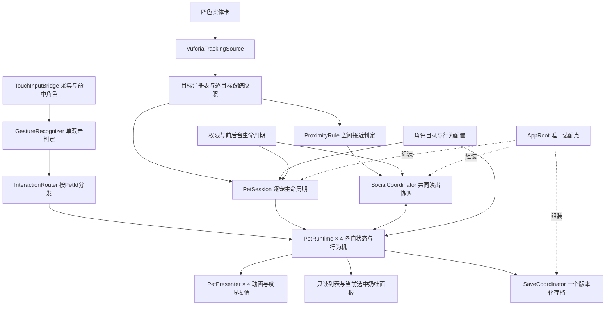

# 四色奶蛙互动改版：架构与实施计划

> 后续进展（2026-09-21）：用户另行授权的文档与资产映射收口已完成，现役交接见 [四色映射](../../Docs/四色奶蛙资产映射.md)。本文保留设计时点的现状与待办推导；参数/动作提案、代码/新库未实施及独立审查未完成的状态不变。

> 日期：2026-09-21；状态：规划稿 v1。基于本轮源码、资产路径及文本记录核查，尚未实施、构建或运行测试。
> 用户已确认：开心值与好感度合并；最终四色四只同屏；删除食物卡；点击/双击提高开心值；100%开心触发各自专属动作；不同奶蛙靠近后共同大笑。
> 独立审查状态：设计子代理连续空返回且未产出文件，本稿改由主代理完成，未获得独立代理审查通过结论。

## 1. 结论：保留七层架构，重构单宠业务模型

**需要重新设计核心对象及协作关系，但无需推翻已有七层架构、Unity 工程或 Vuforia 技术选型。**

旧业务模型是“一只宠物 + 一张小窝卡 + 一张食物卡”；新业务模型是“四个独立角色 + 四张角色卡 + 触屏互动 + 角色间共同演出”。差别集中在身份、状态所有权和跨宠协作，单纯增加三份材质或复制三个 AppRoot 无法解决。

保留跟踪、交互、行为、表现、UI、持久化和平台分层；将固定 Den/Food 槽位改成目标注册表，将单份状态机改成按角色管理的实例，引入一个轻量的共同演出协调器。相机、输入采集、存档写盘和平台生命周期仍由全局服务负责。

最终体验主线：**摆出角色卡 → 对应奶蛙出现 → 点击/双击积累开心值 → 满值触发性格演出 → 移动卡片让伙伴靠近，一起大笑 → 保存各自进度。**

## 2. 已有实物与真实缺口

以下路径均相对项目根目录。此次未打开图片或 Blender 二进制文件；“文件存在”与“Unity可运行”分开记录。

| 核查对象 | 本轮证据 | 对计划的影响 |
|---|---|---|
| 四张新卡 | `Docs/AssetReview/20260920_卡面2D/picked/` 中 `classic/calm/rage/divine.png` 及四份 `*_vuforia.jpg` 全部存在；`raw/*_定稿.png`、deliver 分类目录也有定稿 | 接受用户“设计已好”的最新说明，进入数据库接入；旧 README 仍写其余三卡待出图，已滞后 |
| 四色形象 | `Docs/AssetReview/20260919_卡面基准形象/out/role_*.png` 四份立绘、`work/tex_variant/Pet01_BaseColor_*.png` 四色贴图、`work/pet01_work.blend` 和 `pet01_surgery.blend` 存在 | 四色制作成果可复用；工作副本不直接取代冻结主模型，需选定真正用于运行期的源文件 |
| 换色方式 | 同目录 `work/make_skin_variants.py:1` 注明只改颜色，不改网格/骨骼/UV，脚本中四色配置存在 | 优先共享网格和骨架，导入四套外观配置，不需要重做四套绑定 |
| Unity模型和材质 | `ARPet/Assets/_Project/Art/Characters/Pet01/Models/` 有基础FBX与Idle/Eat/TouchReact/DozeLoop/WalkLoop；Materials 只有 Skin/Oral/Eyes 三份 | 未发现四色运行期材质/Prefab已接入的证据；需要完成制作成果到Unity资产的交接 |
| 动画可用性 | `Pet/PetConfig.cs:222` 仅Idle/Eating返回true，Petted/Resting/Chasing均false | 不能把FBX已存在当作触摸动作可运行；先接TouchReact；四个专属动作和共同大笑仍是新增交付 |
| 当前数据库 | `ARPet/Assets/StreamingAssets/Vuforia/ZQXS.xml:4` 只有food/den两个placeholder，尺寸均0.1×0.1m | 新角色数据库未接入；不能只修改场景名替代真实数据库生成 |
| 同时跟踪数 | `ARPet/Assets/Resources/VuforiaConfiguration.asset:21` 为2 | 双目标已有基础，四目标仍须配置和真机确认 |
| 固定槽位 | `Core/TrackingTypes.cs:10` 为Den/Food；`AR/VuforiaTrackingSource.cs:48` 为长度2数组；`Core/ArContracts.cs:46` 为ToDenLocal | 跟踪契约、真实源、模拟源和坐标转换均需一起泛化 |
| 单宠装配 | `App/AppRoot.cs:59` 单份Needs/Behavior/Save；`:188` 固定读Den/Food | 引入会话和逐宠运行实例，不能复制全局入口 |
| 单宠输入 | `App/TouchInputBridge.cs:29` 单碰撞体；`:122` 命中结果是bool；`:81` Canceled和Ended共用路径 | 必须返回命中的角色身份，区分取消与抬起，新增单/双击识别 |
| 行为与结算 | `Pet/BehaviorStateMachine.cs:29` 去重键含MarkerSlot；`:179` 用静态动画白名单；`BehaviorPolicy.cs:95` 按枚举列单次行为 | 去重加入实例与事件流身份；行为定义和可用能力数据化；复用唯一结算原则 |
| 表情/可见性 | `Presentation/PetPresenter.cs:85` 只有颜色请求，`:134` 可见性方法尚无隐藏动作 | 大笑需要真正嘴眼表情资源；逐宠跟踪隐藏是必做项 |
| 存档 | `Persistence/SaveFile.cs:19` schema=1、`:26` 单份State；`SaveService.cs:209` 迁移仅改版本号 | 实现真正v1→v2数据迁移，不可只提升版本常量 |
| 生成与构建 | `Editor/ProjectSetup.cs:616` 固定两占位目标；`:735` 主场景准备、`:986` 构建调用准备方法 | 工具必须同步改造，否则后续构建会重新套用旧目标属性 |

源码引用前缀除特别注明外为 `ARPet/Assets/_Project/Scripts/`。AGENTS.md记载的98/98 EditMode及双占位卡真机识别是旧基线证据，本次没有重跑，也不代表四宠验证通过。

## 3. 范围与默认玩法规则

### 3.1 已定项

- 四种角色：classic暖黄、calm湖蓝、rage朱红、divine紫；每种拥有独立开心值、演出和存档条目。
- 每款卡唤出对应奶蛙，最终四色四只可以同屏。所有角色卡从开始即可识别，不因旧“皮肤解锁”设计屏蔽实体卡。
- 开心值统一表达用户所说的好感度；不额外增加长期好感条。
- 食物卡玩法退出新版本，不再以前置进食真机测试阻塞新主线。

### 3.2 推荐规则（2026-10-27 用户已定稿）

> 2026-10-27：本表数值已由用户定稿，四色差异见 [专属动作与阈值参数建议 v0.1](专属动作与阈值参数建议_v0.1.md) §3，并已进入 `PetBehaviorConfig.asset`；下表为起始值，可在资产中调参。

| 项目 | 推荐起始值/行为 | 理由 |
|---|---|---|
| 数值范围 | 内部沿用0～1，界面显示0～100%；新角色初始60% | 兼容现有Happiness，首次演出容易体验 |
| 单击 | +6个百分点，短促TouchReact | 复用现有配置幅度与动作 |
| 双击 | +10个百分点，TouchReact加更明显嘴眼/轻量特效 | 动作资源可复用；双击不结算两次单击 |
| 单/双击互斥窗口 | 首次抬起后等待约0.28s，第二次有效抬起在窗口内才算双击 | 确保数值只结算一种手势 |
| 交互冷却 | 接受交互后同一角色0.7s；忙碌时拒绝新的数值交互 | 对齐现有0.7s TouchReact；其他奶蛙仍可点 |
| 满值演出后 | 开心值从100%回落到70%，界面提示“开心释放”，再次积累可重播 | 让满值行为有明确可重复循环，避免永远停在100% |
| 满值演出间隔 | 同一角色至少8s；重新达到100%时最多保留一次请求 | 防连续重入；参数入配置 |
| 自然衰减 | 本轮建议关闭开心值在线/离线自动衰减 | 核心是轻松互动与演出，不再保留为照料玩法服务的惩罚 |
| 饥饿与精力 | 建议退出新主线数值与行为门槛；Doze可将来作为待机变体 | 删除食物后饥饿无补充渠道；精力不应无补充地封锁互动 |
| 共同大笑收益 | 首版只演出，不额外加开心值 | 靠近本身已有反馈，避免大笑与满值动作相互自动触发 |

满值释放后的70%、单/双击增量、冷却、动作候选均可在体验阶段调参。若用户希望100%常驻而非释放，必须相应设计另一种重新触发方式，不能只删除回落而留下每帧满值重播。

原范围中的追球、拍照、反应解锁未被用户明确取消：本轮建议追球延后（WalkLoop仍有历史缺陷）；拍照作为主线之后的交付项保留；解锁简化为“首次看过专属演出/共同大笑”的收藏记录，规则再定。延期建议不等于已获准删除这些原交付项。

## 4. 架构与职责

图中实线表示运行时信息流，不表示程序集引用。

| 层/位置 | 改版职责 | 复用/新增 |
|---|---|---|
| Core | TargetId/PetId/VariantId、跟踪快照、手势与共同演出请求、只读状态与表现契约 | 泛化现有契约；不包含Vuforia类型 |
| AR | 按目标ID注册Observer、发布同帧位姿与跟踪质量、统一米制空间 | 改造Vuforia/Stub与Registry，保留跟踪状态和新鲜度原则 |
| Interaction | 单/双击互斥、角色事件路由、接近/离开/停留判定 | 替换单宠TouchPokeRule；新增ProximityRule；删除FeedingRule运行链 |
| Pet | 每宠开心值和行为、满值资格与唯一结算、共同演出资格及协调 | 保留单宠状态机的职责；新增轻量SocialCoordinator |
| Presentation | 逐宠外观、Animator、嘴眼、特效和实际隐藏/恢复 | 不依赖Pet；通过Core契约接收已解析指令 |
| UI | 四宠可见列表、选中角色开心值、各自跟踪提示/冷却 | 替换只读单宠面板，保留安全区与输入隔离 |
| Persistence | v2多宠存档、v1迁移、单写入器、异常恢复 | 保留已有持久写入/恢复设施，改状态结构 |
| Platform | 单相机权限、前后台、照片保存 | 继续全局一份 |
| App | 构造服务、绑定资产/场景、驱动统一更新顺序；PetSession负责会话装配生命周期 | AppRoot保持唯一，不写手势/几何/阈值业务 |
| Editor | 根据同一目录生成目标、角色、Animator能力清单和构建校验 | 清理两占位目标常量，不让构建回写旧场景 |

依赖约束继续由asmdef保持：AR→Core；Presentation→Core；Pet→Core；Interaction通过Core契约交付候选事件（逐步收窄不必要的Pet依赖）；App可以引用各层。协调器属于Pet，只接收Interaction已判定的关系与参与资格，不读取Transform或调用Vuforia。UI使用Core只读会话视图。

此规模不需要ECS、DI框架、网络同步或通用工作流引擎。新增抽象只服务于四宠身份、事件归属和共同演出三个实际问题。

### 4.1 核心对象定位

- **PetVariantDefinition（配置资产）**：稳定形象ID、显示名、专属行为的对应关系；不保存开心值。外观资源由独立外观配置关联，避免Pet引用Presentation程序集。
- **TargetBinding（配置记录）**：数据库目标ID→形象ID→本地宠物ID；绑定有效印刷宽高与角色局部挂点。库名/图像修订不改变宠物存档身份。
- **PetSession（App中的会话对象）**：组装已配置的四个角色运行实例，连接全局服务；不决定开心值或距离规则。
- **PetRuntime（领域实例）**：组合一份状态、行为机和满值资格；纯C#对象，按PetId隔离，可以脱离场景步进。
- **GestureRecognizer / ProximityRule（判定组件）**：有界的手势/接近会话状态，由外部时钟与快照驱动，方便验证边界。
- **SocialCoordinator（领域协调对象）**：只管理共同演出会话、参与者预留、同步启动与取消；不持有第二份开心值，不取代各宠行为机。
- **IPetPresenter / IAppUiState（边界接口）**：前者隔离Unity表现，后者提供只读列表和选中态；实现对象不能因此获得随意修改开心值的入口。
- **BehaviorDefinition（设计数据）**：稳定行为ID、单次/循环语义、优先级、演出定义；逐步替代按颜色及每个新动作扩switch。共用有限执行状态枚举可以保留，但四款专属表现不各写一套状态机。

运行期索引可用C#集合，Unity Inspector/JsonUtility序列化目录用可序列化记录列表，加载后构建索引；不要假设JsonUtility支持Dictionary或任意接口多态持久化。

### 4.2 身份和生命周期

首版每个肤色只有一个本地个体，例如形象`classic`、个体`pet_classic`、目标`pet_classic_v1`分开命名。每次Observer启停还有运行期代次，防旧回调写入新会话。

一张角色卡对应一个实例；同一幅图打印两张不作为两个独立个体支持。首版只启用每个目标的一份观察者，不承诺同款重复卡能稳定区分；该限制不影响四色各一张同屏。

首次发现时创建/启用视图并恢复对应状态。短暂丢失：立刻关闭该宠命中与空间交互，取消其未完成手势/新接近停留，冻结本地行为时钟并隐藏可视根（可短淡出）；数据实例保留，不重置数值。恢复后只显示并恢复独立行为，不制造第二个进入事件。共同演出采用下文整组取消契约。离开场景时统一释放视图与事件订阅并写盘。

不能关闭承载Vuforia Observer的目标物体来隐藏奶蛙，否则会失去后续恢复事件；只隐藏角色可视子树并禁用命中组件。

## 5. 点击、双击与开心值闭环

1. 输入桥按pointer/finger身份采集，按下时排除UI并射线命中最近的可交互角色，保存PetId；不再只返回bool或以当前UI选中角色替代真实命中。
2. 抬起必须仍在同一角色有效命中区，且时长、移动量符合点按规则。移动阈值使用屏幕缩放/DPI可回退的配置，不能直接把固定40px视为所有手机一致。
3. 第一次合格抬起进入0.28s等待，可立即给无数值的点触高亮；不提前加开心值或播放占用行为通道的完整TouchReact。
4. 窗口内同一角色第二次合格点按组成一次DoubleTap，取消待发SingleTap。两次点在不同奶蛙上分别按各自窗口处理，绝不合成双击。
5. 窗口结束且角色仍可用才提交SingleTap。首版同时只处理一个活动指针，多指额外触点忽略；finger不能在触点重排序时被替换。Canceled只取消，不作为Ended。
6. UI从按下到抬起覆盖、跟踪失效、切后台会清除相关指针及待判单击。恢复后不补发；拖动、长按本轮不产生开心值。
7. 路由后的事件包含PetId、输入流身份、会话代次和唯一序号。行为层是接受与数值结算唯一入口；重复/被拒绝事件都不能重复接受。
8. 被接受的手势即时结算一次开心值。未满值进入TouchReact；到满值则直接进入专属演出，不额外播放另一段TouchReact，也不重复加分。没有可用正式演出时按能力清单禁用或使用明确标注的开发占位。

忙碌期间不接受新的数值点击，UI可提示“正在开心”；不要静默储存一长串触摸事件在演出结束后补加分。点击不同奶蛙互不影响冷却。共同演出与单宠专属动作都锁定参与者行为通道，但不锁其他奶蛙。

## 6. 满值专属动作：每款一种，触发机制共用

### 6.1 演出提案

以下是动作制作前的候选表，不是已制作资产或用户已经定稿的动作。

> 2026-09-22 更新：基于表情包素材视觉审查的逐色演出细化与阈值参数差异化建议见 [专属动作与阈值参数建议 v0.1](专属动作与阈值参数建议_v0.1.md)（统一100%触发、四色在加分/回落/重装/冷却/时长上差异化）；触发机制契约（§6.2）不变。同日用户决定：四色选型定稿为候选A；共享大笑夸张化制作，身体后弯至90°可接受，本节表中后仰幅度描述被建议稿 §2.5 的大幅版取代。

| 形象 | 候选动作 / 行为ID | 关键节奏 | 表情与廉价增强 | 建议时长 |
|---|---|---|---|---|
| 暖黄 classic | 得意三连晃 / `classic_proud` | 挺身、左右小幅摆动、回到满足姿态 | 开心弧眼、短微笑、两三颗星点 | 2.0s |
| 湖蓝 calm | 佛系点头 / `calm_zen` | 缓慢轻摆、闭眼点头、悠然停顿 | 舒展嘴角、淡蓝涟漪 | 2.5s |
| 朱红 rage | 兴奋怒吼 / `rage_roar` | 轻蓄力、抬头怒吼、回弹收势 | 圆睁眼/倒八眉、横椭圆张嘴、短火花 | 2.0s |
| 紫 divine | 神格觉醒 / `divine_awaken` | 端立静止、抬头、慢速回正 | 保留纯白眼设定，紫金光环增强 | 2.5s |
| 全部共用 | 一起大笑 / `social_laugh` | 同时张嘴、身体小幅节奏摆动、共同收势 | 横椭圆口腔、上排小牙、笑眼/神格白眼的专用变体 | 2.4s |

rage的“愤怒”是兴奋到极致的角色化演出，不表示开心值变负；界面采用“兴奋怒吼”避免语义误解。蓝蛙不必复刻倒挂，红蛙不需要制作战马，紫蛙不需要为了动作新增长袍布料模拟。卡面用于表达性格和识别，不强制把所有道具变成运行期三维资产。

冻结模型存在手臂牵拉肚皮、非根骨平移的既知限制，提案采用小幅旋转；仍须逐段验证。若连小幅身体/头部旋转也牵扯网格，先收小幅度，表情/特效承担主要表达。动画源沿冻结骨架加Action→检查→FBX回读→Unity接线，不能因工作目录存在surgery副本就默认冻结版本已解冻。

### 6.2 一次触发和恢复契约

- “达到100%”指合格交互将夹紧后的内部开心值从小于1推到1，不用每帧浮点相等检测；UI不能提前把99.x%四舍五入显示成已满。
- 每宠维护一个满值周期资格：可触发→本周期待执行/执行中→已释放。一个周期只能开始一次。
- 正常场景中满值由被接受的手势直接触发。已有单次动作或共同演出期间手势被拒绝，通常不会产生满值；加载时待执行、配置变更等请求最多保留一个，并在资格满足时仲裁，不堆队列。
- 专属动作成功获得行为通道时，原子地消费本周期资格、开始演出并把开心值释放至70%；数值与资格一起成为可保存状态。该次已消耗的周期即使被打断也不返还，恢复不重复加分/重复开始。
- 重新武装需开心值≤80%且距上次专属动作开始至少8s，再由新交互升至100%。若8s内已攒满，只挂起一条满值请求，等待冷却结束及有效跟踪；期间不衰减，完成资格不丢失。
- 普通跟踪短失时独立专属演出冻结后继续，不重新从0播放；若切后台或资源销毁则结束当前演出，已消费资格不返还。记录首次完整观看与“开始过一次”分开，避免未播完就算看过。
- 行为时钟为完成的唯一权威，采用固定配置时长与1倍速；动画事件仅用于声音/表情提示，不再结算开心值。未来切换为动画完成回调时必须以同一执行ID幂等完成，并关闭原时钟正常结算入口。
- 新存档保存资格与数值，不保存当前动画进度；载入时不因值为100%自动触发。已存待执行周期先显示“开心已满”，首次新的有效点按可确认启动而不再加分；已消费的周期不恢复演出。
- 首次从v1迁移且Happiness=1：标记可确认的待执行周期，用户再点击即可观看一次；不要求没有衰减的玩家先等待数值下降。

### 6.3 表现资源复用

共用一个基础Prefab、四份外观配置、共享Idle/TouchReact/Laugh和四个独占片段。必要时用AnimatorOverrideController映射专属槽位，各实例拥有独立Animator，不复制四套业务脚本。

Build/Editor在装配时验证状态名、AnimationClip、循环属性、时长与表情引用，向Pet提供只读“可播放能力”结果，替换全局`HasAnimatorClip`硬编码。缺失某款专属动作只影响该动作，不应令其他三只不能启动。

嘴眼须制作独立纹理/图集或面片，正确绑定Built-in Standard使用的材质属性（不能沿用当前默认`_BaseColor`就认为生效）。使用逐Renderer属性或独立实例，防一只换表情导致四只共同换色。神格白眼保留其身份特征；共同笑通过嘴和节奏成立。音效仍需实际可用素材，不将已有视频音轨视为可直接使用的笑声。

## 7. 靠近共同大笑：跨宠协作契约

### 7.1 空间条件

- 只接受同一跟踪会话、同一Unity世界坐标系、同帧采样批次里直接Tracked且新鲜的两张卡；ExtendedTracked、Limited、Lost不计入。当前适配器SampleTime是轮询时间，需确保来源状态有效，不能仅靠不断刷新时间戳把旧Transform当新位姿。
- 以两卡对称的相对平面关系判定，而非旧Den全局参照。比较目标法向夹角与相互投影高度，避免一张竖卡与一张横卡误触发；角色视觉根的微动不参与距离判定。
- 起始调参建议：卡中心水平距离≤0.18m、双向高度差≤0.035m、法向夹角≤20°，连续0.6s。退出距离≥0.23m，保持0.3s才确认分开；进入退出迟滞用于抗抖。
- 现有奶蛙约高20cm、宽13cm，在66×94mm小卡上较大；先按0.18m中心距验证不穿插。四宠拍摄覆盖若吃紧，可把显示高度统一调至约12～15cm后重定空间阈值与命中范围。参数是建议，不能照搬旧投喂10cm阈值。

### 7.2 从关系对合成一个演出组

四只最多六对关系。由达到停留条件的关系形成相连群组：A靠近B、B靠近C，则ABC作为同一个组一起笑，语义是“相邻伙伴相互带动”，不要求A和C也直接邻接。这一传播规则为本稿建议。

一个参与者同一时刻只能属于一个演出会话。组成立时冻结成员清单，不在动作中途增补成员。空间分离的AB与CD可各自发起一次；互相有连接则合并为一个四宠会话。排序使用稳定PetId，让同一输入快照得到同一组划分。

### 7.3 预留、仲裁、同步与取消

1. ProximityRule只发布接近候选和可用性，SocialCoordinator检查每名参与者有Laugh资源、无未开始的满值高优先级请求、处于可让出的Idle等状态、个人与组冷却已过。
2. 仲裁顺序：跟踪/后台取消优先；已开始的单次演出不被新的正常请求打断；同帧尚未开始的请求按**满值专属→共同大笑→普通TouchReact→Idle**排序。共同演出只在所有成员都可预留时接受。
3. 若有人尚在TouchReact/专属动作，候选最多保留2s，并且成员与接近条件必须持续有效；超时丢弃。角色之后恢复空闲可重新开始0.6s资格判定，不能无期限占位。
4. 主线程一次更新中先预留全部成员，再统一提交相同会话ID与开始时刻。任何预留失败全部释放，不允许A先笑、B拒绝的半套结果。App统一采样→判定→仲裁→提交→表现更新，避免四个Update各自抢占。
5. 开始时所有Animator统一1倍速、相同过渡和起始相位；轻微朝向调整只作用于角色视觉子根，不旋转Vuforia目标或用于空间判断的锚点。朝向可朝组中心，演出后恢复局部默认朝向。
6. 任一成员丢失、切后台或持续离开退出区，则整组取消：所有参与者退出会话，仍可见者回Idle，丢失者隐藏。后来的两只可以在新一轮合格接近中发起新组，但不接续旧会话。
7. 正常完成或开始后被取消都消费本次接近机会，开始时即记录参与者冷却（建议5s）。候选尚未开始失败不消费机会。
8. 同一次接近只触发一次。会话开始时锁住该成员组内部的所有关系对（不只锁连通树上的边）；只有两卡持续有效且真实离开退出区后对应关系才重新武装。丢失、恢复、改变组ID都不能当成已离开；避免ABC拆为AB/BC马上重新刷演出。
9. 新成员D靠近已完成ABC时，只允许以重新合格且未锁的关系构造候选，锁住的旧关系不能被包含在新组中；若会造成同一角色出现在多个候选，以稳定顺序选一个并取消其余，仍须个人冷却。这个规则让新伙伴可发起互动，又不靠组成员变化绕过旧接近锁。
10. 共同大笑不加开心值；完成记录由协调器以会话ID提交一次，再按每个成员记录首次观看，不由每对关系、每只Animator分别结算。

重新打开应用不恢复正在播放的共同会话，也不把启动时已经贴在一起的卡立即当新进入：首次有效采样先初始化接近锁，先分开再靠近才触发。界面可提示“把卡片分开，再靠近试试”。

## 8. Vuforia新数据库接入与场景改造

1. 以`picked/*_vuforia.jpg`四份为上传输入，确认后续不再改裁切、印刷内容或增加文字；如改图需对应重建目标。新库建议`ZQXS_Pets_v1`，目标`pet_classic_v1`、`pet_calm_v1`、`pet_rage_v1`、`pet_divine_v1`。
2. 目标物理尺寸使用整个上传图对应的印刷范围。若上传版整张就是66×94mm卡面，宽填0.066m，导入后复核高约0.094m；780/1110与66/94有极小栅格取整差，以实际印刷和SDK按比例结果为准，不拉伸为0.1m正方形。保护套70×99mm不是目标尺寸。
3. Target Manager逐张记录星级，目标≥3；classic历史4星不代表其余三张已评级。本轮没有登录门户核查新评级。若门户有干扰分析可保存其结果；始终另做四卡六种配对与四卡同时出现的真机错认验证，不把门户分析与真机混为一谈。
4. 导出Android/Unity设备数据库包并导入项目，核对新XML/DAT与资源meta，更新TargetBinding和场景Observer；授权Key不写入设计或日志。
5. 先以四目标目录支持其中两只同时运行，完成任意两款辨识、独立锚定和逐宠丢失恢复。然后将`MaxSimultaneousImageTargets`设4，并核对当前Vuforia11.4.4支持的实际配置与运行结果；不能仅改数字就报告四目标通过。
6. 更新ProjectSetup所有主场景准备、创建材质/Animator、目标初始化、检查和构建调用。保留此前`mInitializedInEditor=true`等真实初始化修复；统一父级与尺寸，四个ImageTarget都不要意外嵌套在其他目标之下。
7. 新运行场景去掉Food目标、旧Den业务挂点和占位观察者，新版构建只打包新目标库所需文件。旧基线场景/数据库在迁移分支或归档中留有可回溯版本；这不代表继续保留食物玩法入口。
8. 使用已验证的Unity6000.0.83f1 / Vuforia11.4.4 / Built-in工具链与`Tools/Unity/build-android-apk.ps1`构建；沿用SDK超时环境配置。无需为这次玩法改版更换引擎。

最早就安排四目标纯跟踪试验：四张66mm宽的卡需要更大的视野，移远手机又降低每卡像素，实际可能受识别距离和光照制约。若四宠不稳定，应先调整布局、打印/保护套反光、摄像距离和显示比例；最终四宠目标仍保留，失败作为未通过验收记录，不擅自宣称双宠即最终完成。

## 9. 删除食物卡的完整迁移面

| 对象 | 处理 |
|---|---|
| 运行链 | 移除AppRoot的FeedingRule构造/逐帧判定/后台处理，移除Feed事件来源；泛化Den坐标依赖 |
| 行为配置 | 移除新配置中的Eating与EatConfig、饥饿门槛及讨食提示；保留可回溯的旧资产，不为删除玩法破坏冻结源文件中的Eat Action |
| 状态数值 | 新运行态只保留开心值及必要统计；按本稿建议同步停用Hunger/Energy衰减和其交互阻断 |
| UI | 删除Hunger/Energy/FeedingReason显示，改为选中奶蛙开心值和逐宠提示 |
| 持久化 | v1 FeedCount/Hunger/Energy仅供迁移识别/历史备份，不进入新行为判断；不改变旧枚举数值后直接读旧文件 |
| 解锁 | 有投喂依赖的既有/未来配置改为明确的新观看或点击条件；历史FeedCount不换算成新开心奖励 |
| 场景与工具 | 清除食物观察者、生成菜单和构建前自动恢复旧两目标的路径 |
| 回归 | 旧FeedingRule专项测试随功能退出；保留并迁移“去重、丢失不结算、打断、异常存档”等通用性质，新增多宠与手势边界 |
| 报告 | 开题到最终范围的变更要如实记录：实体投喂替换为角色卡靠近共同演出；历史实测仍作为历史，不改写成新玩法证据 |

## 10. 多宠存档、UI与异常处理

### 10.1 存档v2

单个全局SaveCoordinator汇总四份状态，避免四个实例争写同一个JSON。按稳定PetId保存开心值、合法交互计数、满值周期资格、专属演出观看记录；全局保存照片/总游玩时间等已有合法统计。目标位姿、Transform、Animator、正在播放的组会话不落盘。

v1读取必须先依据版本解析旧DTO，将旧Happiness和PetCount迁入黄蛙，其他三只按新默认值初始化；保留能解释的全局统计，不把黄蛙进度复制四份。旧UnlockedReactions仅迁移新版本仍认识的稳定ID，未知项保留在旧备份中，不伪造已解锁。

迁移做范围/NaN校验、备份，再用现有持久写入流程提交v2；不能先写版本号再发现数据丢失。未来版本、损坏文件、重复PetId、缺少某只的条目均需明确处理：未来版本不覆盖，损坏沿既有恢复路径，重复ID按确定规则拒绝/回退，缺少项初始化补齐。

冷却使用运行期单调时钟；重启给一个短保护期，不序列化`Time.time`。满值资格随存档保存以阻止重复开始；异常断电最多回到最近合法存档，本单机项目不承诺跨崩溃严格分布式exactly-once。后台和退出主动Flush，普通变化沿用节流，不每帧写盘。

### 10.2 UI

屏幕提供四款小头像及各自可见/寻找状态，点击3D角色或头像选择查看对象；只有实际命中3D角色的合格手势加开心值，切换UI选择不加分。主面板只显示选中奶蛙的开心条和当前演出/冷却；多宠同时发生时不把四套大型HUD叠满画面。

单卡丢失只提示对应奶蛙，其他角色继续独立互动；权限失败/后台为全局暂停。适配Safe Area及平板尺寸，保留UI阻止输入穿透机制。

### 10.3 错误与并发

所有游戏状态在Unity主线程按固定顺序推进。平台/Vuforia回调转为本帧待处理通知，携带会话代次；旧代次通知忽略。四宠不需要四个线程，组预留和提交在同一主线程决策阶段完成。

缺少目标绑定或重复ID是编辑器/构建错误，应阻止产出错误配置；运行期无法创建某宠则提示具体角色不可用，其余有效宠继续。缺少Laugh能力则该宠不被纳入共同演出；不能把“播放指令发出”当成真实资源已经成功播放。丢失、拒绝点击、等待双击属于正常状态，不刷错误日志；资源缺失、数据库加载失败、迁移失败记录可定位信息。

## 11. 分阶段plan与验收

工作量为1人、熟悉现有Unity工程的工程估算，不是承诺工期。下表合计约17～29个有效工作日，不含等待Target Manager/打印和动画大返工；如仍只有约4周，需要每天至少形成一个可展示增量，尽早做四目标试验并控制非主线范围。

| 阶段 | 任务与依赖 | 可演示成果 / 验收门槛 | 估算 |
|---|---|---|---|
| P0 方向和资产收口 | 同步新范围；登记四色源模型/贴图/卡面/目标ID；选择运行源；确认动作提案和规则参数 | 一张资产映射清单和新范围文档，明确哪些设计好、哪些待Unity接线；取消旧进食前置 | 0.5～1天 |
| P1 新库与多目标风险前置 | 上传四卡、导出库；建立隔离开发场景测试2→4个Observer；量实际印刷尺寸 | 四目标均可单独识别；两目标稳定；四目标可行性记录、实际可见数及错认记录 | 1～2天 |
| P2 双宠架构竖切 | 泛化Core/AR/Stub；PetSession和PetRuntime；移除运行期食物/饥饿依赖；逐宠可见性；最小v2存档 | 两张角色卡唤出两只不同颜色，各自丢失/恢复不重建状态，其他一只可继续；旧存档黄蛙进度保留 | 3～5天 |
| P3 手势与满值闭环 | 多宠命中、单/双击互斥、开心条、唯一结算；先接TouchReact；专属行为用明确开发占位 | 点黄蛙不改蓝蛙；双击只加一次10%；100%只开始一次；结束70%；保存恢复不偷触发 | 2～3天 |
| P4 共同演出逻辑 | 接近/离开/组协调/优先级/取消；用统一占位片段验证 | 双宠同帧开始；ABC链只有一个三宠会话；AB/CD可独立；有人丢失整组取消，重入不重复结算 | 2～3天 |
| P5 正式动作与嘴眼 | 一段共享Laugh→四段专属Action；回读验证→Animator能力接线→表情与必要特效 | 先交一组真正会笑的双宠，再逐款替换占位；所有动作可播放、无空状态、无明显穿地/腹部破面 | 5～9天 |
| P6 四宠整合与移动端验收 | 四材质实例、全套输入/UI/存档；补全退出食物链；新库打包 | 最终四色同屏、六配对与四宠靠近有效；权限/后台/损坏存档可恢复；实际帧率和温升记录 | 2～4天 |
| P7 文档、演示与交付 | 汇总已实现/已测/待验证；APK、打印卡、说明与演示 | 仓库一份最新事实入口，四卡示范路径、设备/光照/距离与限制可复查 | 1～2天 |

> P4/P5 状态（2026-10-27 完成）：P4 未用统一占位片段，直接用正式 social_laugh 验证接近/离开/组协调/取消（`ProximityRule` + `SocialCoordinator`，EditMode 223/223）；组内相位错开与 ±3° 随机未做。P5 的骨骼片段早已完成，本轮补的是二维嘴眼：Head 骨骼下两片贴片 + 图集选格 + 同色遮盖（EditMode 231/231）；特效、音效未做。七轮视觉审查残留轻-中观感问题，真机待测。
>
> P3 状态（2026-10-27 完成）：双击识别窗口、TouchReact 与四段专属 Animator 状态、开心值与开心条已接线，专项 EditMode 161/161；真机待测。与原计划的差异是未用“明确开发占位”验证专属行为，满值直接播 classic_proud / calm_zen / rage_roar / divine_awaken 正式片段。

主依赖链：P0→P1→P2→P3→P4→P6→P7；P5在P0动作表明确、P2确认骨架/材质后可穿插制作。单人并行仅指在技术等待期间切换任务，不把两个完整工作量算成同一天。P4不等待四段正式动画完成；P6正式验收必须等P5替换占位。

第一里程碑是“双宠可独立互动与恢复”；第二里程碑是“双宠会一起笑且其中一款有专属动作”；第三里程碑是“四款四只完整体验”。这样每阶段都有可演示成果，最贵的四段专属动作不会掩盖跟踪基础问题。

若工期不足，优先简化特效/音效和延后追球，不削掉每宠独立状态、丢失恢复、去重或组原子启动。四宠目标的任何降级须记录并另行决定。

## 12. 后续实现时的验证清单

本轮不运行以下测试；它们是后续施工的验收要求。

- 手势：单击、双击、临界窗口、跨角色双点、多指、Canceled、拖动、UI覆盖、窗口内丢失与后台，均验证事件和加分次数。
- 满值：99%到100%、100%连续点击、消费资格/8s冷却、动画忙碌、加载满值确认、丢失恢复、完成回调重复、配置缺片段。
- 多宠：A丢失不阻断B；事件同号但不同PetId不串号；卸载/重建后旧回调被忽略；材质/Animator不会串色串表情。
- 社交：六个配对、ABC链、AB/CD两组、四宠全连通、同时满值与靠近、部分预留失败、成员移走、隐藏再出现、变组规避锁、冷却到期但未分开不重播。
- 数据：v1正常/满值/损坏存档、缺少条目/重复ID、写盘失败、备份恢复、未来schema保护；四宠独立进度与解锁来源正确。
- 工具：重复执行ProjectSetup/构建准备不会恢复food/den或0.1m尺寸，不破坏四目标父级；生成的Animator/外观配置都引用真实资源。
- 真机：iQOO Z9 Turbo / Android15先做；记录APK版本、66×94mm有效图、是否套保护套、光照、距离、角度、各卡Tracked状态、错认/恢复次数；至少一轮连续10分钟四宠互动记录平均及低帧/卡顿、发热与追踪丢失。约30FPS为目标，不填成结果。

## 13. 项目文档同步清单

本轮将新计划独立落盘，旧源码与文档尚未整体同步。后续P0按下表修订；记录范围变更与实现现状，不能直接把“计划”写成“完成”。

| 文件 | 应同步内容 |
|---|---|
| `AGENTS.md` | 最新决定：四色、开心合并、四宠、删除食物、靠近大笑；废止“先完成进食再扩展”的旧顺序；保留冻结/工具链纪律；用日期说明历史范围 |
| `Docs/交互与皮肤扩展设计.md` | v0.2从单宠换肤升级为多宠方案；四种ID和颜色、100%统一条件、移除食物/饥饿依赖；修正旧尺寸和卡面定稿状态 |
| `Docs/项目架构与技术架构.md` | 更新真实已实现状态；替换固定双槽/单宠图、契约与AppRoot关系，引用本方案计划；删除“真机尚未执行”等过期总述 |
| `ARPet/README.md`、`ARPet/SETUP.md` | 新库导入、四卡映射、场景生成与构建步骤、已接入动作及多宠验证状态 |
| `Docs/AssetReview/20260920_卡面2D/deliver/README.md`、`raw/生成记录.md` | 四卡定稿/上传版已存在；逐卡评级、目标名、尺寸与实际新库导入状态；历史提示词不当成当前待办 |
| `ArtSource/Characters/Pet01/README.md`与资产说明 | 记录选中的四色源/贴图交接；确认work与surgery工作副本用途；新增Action和回读结果不得冒充已完成 |
| `asset_manifest.json`、`final_manifest.json` | 核实源文件哈希、现存片段、四色贴图路径与Unity导出物；仅登记核实过的能力 |
| 开题说明、最终报告、验收与演示材料 | 保留已提交开题稿历史，添加范围变更说明；新验收用触屏和角色卡协同替代实体投喂，不虚构进食/四目标历史成绩 |

下一步最有价值的实施是**P0资产映射与文档收口 + P1新库和四目标可行性试验**，随后进入P2。首先证明四张真实卡与四个独立实例可以可靠共存，再完成互动与动画表现。
